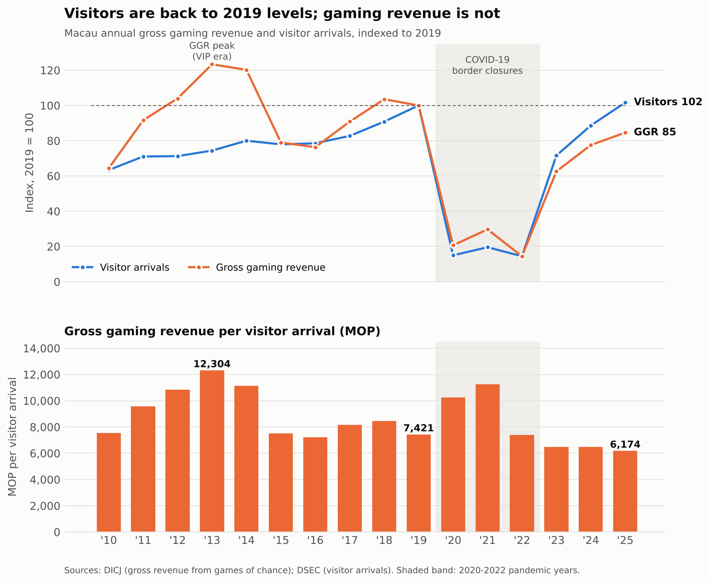
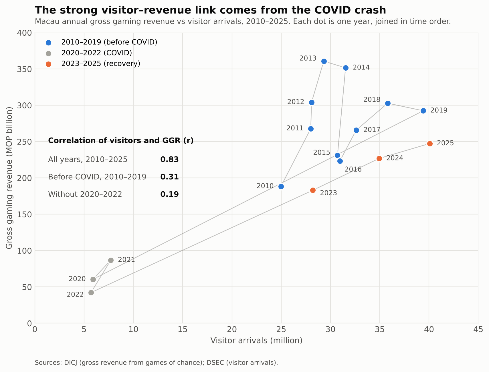

# Betting on Visitors: Does More Tourism Mean More Gaming Revenue in Macau?

**Status:** Ongoing. The preliminary analysis is complete; the next stage looks at *who* the visitors are (see [Next steps](#next-steps)).

## Research question

Does Macau's gross gaming revenue (GGR) rise and fall in step with the number of visitors, or has the gaming revenue each visitor brings in changed over time, especially since COVID-19?

## Dataset

| Series | Source | Unit |
|---|---|---|
| Gross gaming revenue (gross revenue from games of chance) | Gaming Inspection and Coordination Bureau (DICJ), [Gaming Statistics](https://www.dicj.gov.mo/web/en/information/DadosEstat_mensal/index.html) | MOP billion per year |
| Visitor arrivals | Statistics and Census Service (DSEC), [Visitor Arrivals](https://www.dsec.gov.mo/en-US/Statistic?id=402) | million arrivals per year |

The annual totals for 2010–2025 are compiled in [`data/macau_ggr_visitors.csv`](data/macau_ggr_visitors.csv) (16 rows, 3 columns).

**Usage permission:** both series are official statistics that the Macao SAR Government publishes free of charge on the public websites above. They are used here for non-commercial, educational purposes, with the sources cited. The file holds only annual aggregate totals: no personal data, passwords, or API keys are included in this repository.

## Methods and tools

- **Tools:** Python, pandas, matplotlib, Jupyter Notebook
- **Workflow:**
  1. Load the CSV and check it: 16 consecutive years, no missing values.
  2. Build three measures: a GGR index and a visitor index (both 2019 = 100), and GGR per visitor arrival in MOP.
  3. Compute Pearson correlations between GGR and visitors for 2010–2019, 2010–2025, and 2010–2025 without the pandemic years 2020–2022.
  4. Visualise the results in two figures and print every number quoted in this README.

The notebook works in 43 short, numbered steps, one idea per cell, so each number can be traced back to the cell that produced it.

## Key findings

**1. Visitors are back, but gaming revenue is not.** In 2025, visitor arrivals reached 102% of their 2019 level, while GGR reached only 85%. Each visitor now brings in about MOP 6,174 in gaming revenue. That is 17% less than in 2019 (MOP 7,421) and about half the 2013 peak (MOP 12,304).



**2. The strong correlation is a COVID effect.** Over 2010–2025, GGR and visitors look strongly correlated (r = 0.83). The reason is that both series collapsed together in 2020–2022. Before COVID the correlation was weak (r = 0.31), and with the pandemic years removed it drops to r = 0.19.



**3. Revenue and visitors have split apart before.** From 2010 to 2013 (the VIP boom), GGR rose 92% while visitors rose only 17%. In 2015, during the anti-corruption campaign, GGR fell 34% while visitors fell only 3%.

**Conclusion:** the number of visitors alone no longer predicts Macau's gaming revenue. The type of visitor (VIP or mass market, same-day or overnight) seems to matter as much as the total count.

## Limitation

The main limitation is that the analysis uses **only 16 annual data points**. With so few observations, a handful of unusual years (such as 2020–2022) can swing the correlation, so these results are indicative rather than conclusive. Other limitations:

- Correlation does not show causation.
- GGR is in nominal MOP, with no adjustment for inflation.
- Visitor arrivals count trips, not unique people.

## How to run the analysis

Requirements: Python 3.9 or newer.

```bash
git clone https://github.com/glry01/data-science-project.git
cd data-science-project
pip install -r requirements.txt
jupyter notebook macau_ggr_vs_visitors.ipynb
```

In Jupyter, choose **Kernel → Restart & Run All**. The notebook:

- reads `data/macau_ggr_visitors.csv`;
- prints every number quoted above;
- saves both figures to `figures/`;
- ends with a check that both figure files were regenerated.

To run it without opening the browser:

```bash
jupyter nbconvert --to notebook --execute --inplace macau_ggr_vs_visitors.ipynb
```

## Repository structure

```
data-science-project/
├── README.md
├── requirements.txt
├── macau_ggr_vs_visitors.ipynb    # the full analysis, 43 numbered steps
├── data/
│   └── macau_ggr_visitors.csv     # annual GGR and visitor arrivals, 2010–2025
└── figures/
    ├── fig1_ggr_vs_visitors_index.png
    └── fig2_correlation_scatter.png
```

## Next steps

- Break visitor arrivals down by place of residence and by same-day vs. overnight stay (DSEC).
- Split GGR by game type, VIP vs. mass-market baccarat (DICJ), to test the "visitor mix" explanation.
- Adjust GGR for inflation and move from annual to monthly data, to get more observations.
